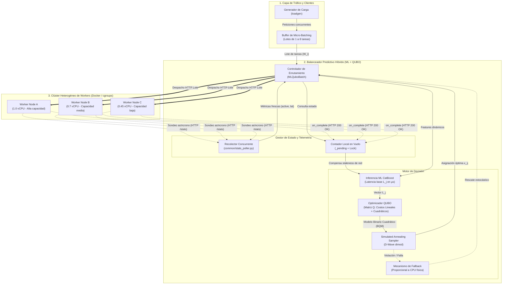
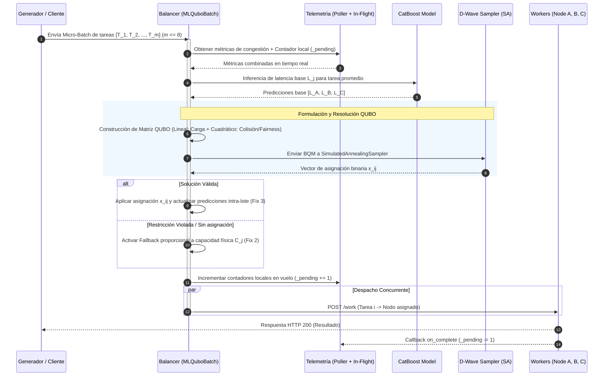

# Arquitectura del Balanceador de Carga: ML + QUBO (Micro-Batching con Simulated Annealing)

Este documento describe la arquitectura del sistema de balanceo de carga híbrido, el cual combina inferencia de Machine Learning (ML) con optimización combinatoria a través de modelos QUBO (Quantum Unconstrained Binary Optimization) resueltos mediante *Simulated Annealing* (SA).

Esta arquitectura está diseñada para escenarios de alta concurrencia en clústeres heterogéneos, mitigando el *Efecto Manada* y el *Concept Drift* mediante una distribución de carga orientada a lotes (*Micro-Batching*).

## 1. Topología y Componentes Principales

El flujo tradicional de cliente-servidor se ha modificado para incorporar agrupamiento de peticiones y resolución de optimización en tiempo real.

### 1.1 Generador de Carga y Micro-Batching (`loadgen/`)
- En lugar de enviar peticiones individuales al balanceador y esperar una decisión aislada, las peticiones entrantes se acumulan en ventanas de tiempo muy cortas para formar **Micro-Batchs** (lotes pequeños, ej. máximo 8 tareas).
- Esto permite tener contexto sobre múltiples tareas simultáneas antes de tomar decisiones de enrutamiento.

### 1.2 Recolector de Telemetría Dinámica (`common/stats_poller.py`)
- Mantiene un sondeo asíncrono y concurrente del estado de los *Workers* (nodos Flask/Gunicorn).
- Proporciona métricas como la cantidad de `active_requests` y `avg_recent_latency_ms`.
- Se complementa con un **Contador Local de Peticiones en Vuelo** (protegido por `Locks` o *mutexes*) dentro de la estrategia de balanceo para rastrear instantáneamente las tareas despachadas entre los ciclos de actualización remota, mitigando el *staleness* de la red.

### 1.3 Motor Predictivo de ML (CatBoost)
- Antes de que el optimizador decida, un modelo predictivo basado en *Gradient Boosting* evalúa el impacto "base" de asignar una tarea promedio a cada nodo.
- El modelo ingiere características de congestión en tiempo real (evitando depender de la supuesta capacidad estática del nodo, lo cual previene sesgos por *Concept Drift* como estrangulamiento térmico de la CPU).
- Genera predicciones precisas de latencia en microsegundos, estableciendo el "costo actual" de cada nodo.

### 1.4 Optimizador QUBO (*Simulated Annealing*)
Es el núcleo central de la estrategia (`MLQuboBatch`). Formula la distribución óptima del lote entero hacia los nodos como un problema matemático de minimización cuadrática.

## 2. Formulación Matemática (QUBO)

Para asignar $M$ tareas de un lote a $N$ nodos, se definen variables binarias $x_{i,j}$ donde $x_{i,j} = 1$ si la tarea $i$ se asigna al nodo $j$.

El modelo QUBO construye una Matriz (o Modelo Binario Cuadrático) que el *Simulated Annealing* buscará minimizar:

### 2.1 Términos Lineales (Costo Base)
Cada posible asignación $x_{i,j}$ tiene un costo lineal asociado.
- Penaliza asignar una tarea a un nodo que **ya tiene alta carga o alta latencia predictiva** (basado en la salida del modelo ML, $L_j$).
- Se pondera según el tamaño relativo de la tarea ($W_{i,j}$) dividido por la capacidad física real del nodo ($C_j$).
- Matemáticamente busca que, si un nodo está congestionado, su costo lineal se dispare.

### 2.2 Términos Cuadráticos (Colisiones y Herd Effect)
Representan la penalización conjunta de asignar dos tareas del mismo lote al mismo nodo o restricciones estrictas del problema:
- **Restricción Estricta**: Penalización masiva si una tarea se asigna a múltiples nodos o a ninguno (Asegura $\sum_{j} x_{i,j} = 1$).
- **Distribución de Carga (Fairness)**: Penaliza asignar las tareas $i$ y $k$ simultáneamente al nodo $j$ ($x_{i,j} \cdot x_{k,j}$). 
- Esta penalización cuadrática escala fuertemente e inversamente proporcional a la capacidad física pura ($C_j$) del nodo. Significa que enviar dos tareas a un servidor pequeño (ej. Raspberry Pi) provocará un castigo matemático inmenso, forzando al solver a repartir el lote uniformemente por el clúster.

### 2.3 Solución vía Simulated Annealing
- Se utiliza la librería `dimod` de D-Wave.
- El problema BQM (Binary Quadratic Model) es introducido a un *Simulated Annealing Sampler*.
- El algoritmo simula un enfriamiento termodinámico para escapar de mínimos locales y encontrar (en cuestión de pocos *sweeps* o iteraciones) el patrón de enrutamiento que minimiza la latencia y saturación global del clúster.

## 3. Flujo de Procesamiento del Lote (Micro-Batch)

1. **Agrupación**: El balanceador recibe un arreglo de tareas `task_sizes` (hasta 8 para evitar una explosión combinatoria).
2. **Inferencia Base**: Se consulta a CatBoost la latencia base ($L_j$) de todos los servidores si recibieran una tarea promedio del lote actual, combinando la telemetría remota y los contadores en vuelo.
3. **Construcción de la Matriz**: Se computan los costos de los términos lineales y cuadráticos, ajustando las penalizaciones según el tamaño de las tareas.
4. **Muestreo (Sampling)**: `dimod.SimulatedAnnealingSampler` ejecuta las iteraciones y devuelve el vector $x_{i,j}$ más óptimo encontrado.
5. **Ajuste Dinámico e Inyección (*Fix 3*)**:
   - Por cada tarea asignada en el lote, se actualiza el costo base del nodo destino en caliente. 
   - De este modo, si la tarea #1 fue al "Nodo A", al procesar la tarea #2, el sistema ya sabe matemáticamente que el Nodo A está ligeramente más saturado.
6. **Mecanismo de Fallback (*Fix 2*)**: Si la formulación QUBO llega a fallar (o no se asigna un nodo por violación de la restricción), la estrategia tiene un mecanismo de rescate que enruta la tarea estocásticamente de manera proporcional a la capacidad física del clúster, evitando caídas (*Crashes*).
7. **Despacho**: Todas las peticiones del lote se emiten simultáneamente por red a sus nodos calculados y se incrementan sus contadores de peticiones en vuelo.
