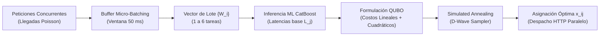

# Metodología, Dataset, Propuesta y Métricas de Evaluación

Este documento detalla la formulación metodológica, las variables del modelo predictivo, la construcción del dataset de entrenamiento, la formulación matemática de la propuesta híbrida (ML + QUBO con Micro-Batching) y las métricas estadísticas empleadas para validar la investigación.

---

## 1. Descripción del Dataset de Entrenamiento

El dataset fue recolectado experimentalmente sobre un clúster heterogéneo de contenedores Docker con aislamiento de recursos mediante `cgroups`.

### 1.1 Estrategia de Recolección (Muestreo Activo en Dos Fases)
Para evitar que el modelo de Machine Learning memorice únicamente estados estables y sufra colapso ante cambios de entorno (*Concept Drift*), la recolección se diseñó en dos etapas continuas:

1. **Fase de Carga Normal (Régimen Nominal):**
   - Todos los nodos operan al 100% de su capacidad nominal configurada (`node-a: 1.0 CPU`, `node-b: 0.7 CPU`, `node-d: 0.5 CPU`, `node-c: 0.45 CPU`, `node-e: 0.4 CPU`).
   - Tráfico sintético con llegadas Poisson con tasa variable (10 a 20 req/s) asignado aleatoriamente para explorar el espacio completo de combinaciones $(carga, nodo, tamaño\_tarea)$.
2. **Fase de Inyección de Falla (*Concept Drift*):**
   - Se reduce en caliente la CPU del nodo principal (`node-a`) de `1.0 CPU` a `0.4 CPU` mediante `docker update --cpus 0.4`.
   - Se continúa inyectando tráfico concurrente. Esto fuerza al recolector a registrar muestras donde la cola (`active_requests`) y la latencia reciente (`avg_recent_latency_ms`) se disparan, enseñando al modelo a reconocer estados de congestión severa.

### 1.2 Dimensiones y Partición de Datos
- **Total de Muestras:** 2,235 observaciones tabulares registradas.
- **Partición de Entrenamiento (*Train Set*):** 1,899 muestras (85%).
- **Partición de Validación (*Validation Set*):** 336 muestras (15%).
- **Rendimiento de los Modelos en Validación:**
  - **CatBoostRegressor (Modelo Principal):** $R^2 = 0.643$, $\text{RMSE} = 93.43\text{ ms}$.
  - **LightGBM:** $R^2 = 0.612$, $\text{RMSE} = 97.42\text{ ms}$.
  - **XGBoost:** $R^2 = 0.610$, $\text{RMSE} = 97.64\text{ ms}$.

CatBoost fue seleccionado como el motor predictivo por su estructura de árboles simétricos (*oblivious trees*), que ofrece la inferencia más rápida y determinística en tiempo real (~2 ms).

---

## 2. Definición y Justificación de Variables

El vector de características (*features*) se diseñó para reflejar la física del encolamiento y el dinamismo de la red sin introducir sesgos de configuración estática.

```
X = [task_size, active_requests, avg_recent_latency_ms, delta_active_requests, 
     delta_avg_latency_ms, estimated_service_time, staleness_ms, node_utilization]
```

### 2.1 Variables de Entrada (Features)

| Variable | Tipo | Unidad | Descripción y Justificación Teórica |
|:---|:---:|:---:|:---|
| `task_size` | Continuo | Operaciones / Flops | Número de iteraciones computacionales de CPU que requiere la tarea. Permite al modelo anticipar si la petición es liviana o pesada. |
| `active_requests` | Discreto | Concurrencia | Tareas activas en el nodo (reportadas por el nodo vía `/stats` y compensadas localmente con `_pending` en vuelo). Captura la longitud de cola instantánea. |
| `avg_recent_latency_ms` | Continuo | Milisegundos (ms) | Media móvil de latencia en las últimas 5 peticiones atendidas por el nodo. Refleja la velocidad de drenaje actual del worker. |
| `delta_active_requests` | Discreto | $\Delta$ Concurrencia | $\text{active\_requests}_t - \text{active\_requests}_{t-1}$. Si es $> 0$, indica que la cola está creciendo (el nodo no da abasto). |
| `delta_avg_latency_ms` | Continuo | $\Delta$ Milisegundos | $\text{latency}_t - \text{latency}_{t-1}$. Captura la primera derivada de la degradación (tendencia de saturación). |
| `estimated_service_time` | Continuo | ms teóricos | $\frac{task\_size}{node\_speed}$. Relación de trabajo respecto a la velocidad nominal; acelera la división aritmética dentro del árbol de decisión. |
| `staleness_ms` | Continuo | Milisegundos (ms) | Tiempo transcurrido desde el último reporte HTTP del recolector de telemetría. Contextualiza la frescura de los datos ante pérdidas de red. |
| `node_utilization` | Continuo | Ratio [0, 1] | $\frac{active\_requests}{8.0}$. Nivel de saturación normalizado sobre el número de hilos trabajadores del servidor Gunicorn. |

### 2.2 Variable Objetivo (Target)
- **`latency_ms` (Continuo):** Tiempo total que tarda el servidor en procesar la petición y devolver `HTTP 200 OK`. 

### 2.3 Justificación contra el *Concept Drift*: Exclusión de `node_speed`
En diseños tradicionales de literatura (ej. Rahimov & Aghayev, 2026), se incluye la velocidad física del nodo como feature estático. En esta tesis **se excluyó deliberadamente como variable independiente fija**. Si el modelo asocia `node-a` con "siempre rápido", cuando el hardware se degrada a 0.4 CPU el modelo comete un error catastrófico de sobreestimación. Al depender de métricas dinámicas (`active_requests`, `delta`, `avg_latency`), el modelo se adapta de inmediato cuando las colas crecen, sin importar la etiqueta del nodo.

---

## 3. La Propuesta: Arquitectura Híbrida (ML + QUBO con Micro-Batching)

La propuesta sustituye las decisiones codiciosas (*greedy*) por una **optimización combinatoria global en micro-lotes**.



### 3.1 Agrupamiento en Micro-Lotes (*Micro-Batching*)
- Las peticiones entrantes no se enrutan de forma aislada, sino que se acumulan en una **ventana deslizante de 50 milisegundos**.
- A una tasa de 14.5 req/s, la ventana agrupa entre **1 y 6 tareas concurrentes** ($\bar{K} \approx 1.70$ tareas).
- Esto reproduce fielmente los buffers de proxies industriales (Envoy, NVIDIA Triton) sin violar los Acuerdos de Nivel de Servicio (SLA) de latencia web.

### 3.2 Formulación Matemática del Modelo QUBO
Para un lote de $K$ tareas y $N$ nodos, se definen variables binarias:
$$x_{ij} \in \{0, 1\} \quad \text{donde } x_{ij} = 1 \iff \text{la tarea } i \text{ se asigna al nodo } j$$

El objetivo es minimizar la función de energía Hamiltoniana cuadrática:
$$H(x) = \sum_{i,j} q_{ij} x_{ij} + \sum_{(i,j) < (k,j)} q_{ij,kj} x_{ij} x_{kj} + P \sum_{i=1}^K \left( \sum_{j=1}^N x_{ij} - 1 \right)^2$$

Donde:
1. **Restricción de Asignación Única (Penalización $P$):**
   - Asegura que cada tarea $i$ se asigne a **exactamente un nodo**: $\sum_{j=1}^N x_{ij} = 1$.
   - El multiplicador de Lagrange $P$ domina absolutamente el espacio de soluciones para evitar violaciones.
2. **Término Lineal ($q_{ij}$ - Resistencia a la Latencia Base):**
   $$q_{ij} = 2 \cdot L_j \cdot W_{ij} + W_{ij}^2$$
   - $L_j$: Latencia base predicha por el modelo CatBoost en el nodo $j$.
   - $W_{ij} = \frac{\text{norm\_task}_i \cdot 10.0}{C_j}$: Esfuerzo de la tarea normalizada sobre la capacidad física $C_j$.
3. **Término Cuadrático ($q_{ij,kj}$ - Penalización por Colisión Física):**
   $$q_{ij,kj} = 2 \cdot W_{ij} \cdot W_{kj}$$
   - Penaliza fuertemente enviar **dos tareas al mismo nodo dentro del mismo lote**.
   - Como $W_{ij}$ escala inversamente con la capacidad física $C_j$, dos tareas colisionando en un nodo lento o degradado reciben una penalización mucho más alta que en un nodo potente.
4. **Resistencia al Efecto Manada (*Herd Effect*):**
   - Se mantiene un vector mutable `dynamic_preds` que incrementa la carga proyectada de un nodo inmediatamente después de asignarle una tarea dentro del mismo lote, evitando que todas las tareas converjan al mismo nodo antes de que la telemetría remota se actualice.
   - **Fallback Estocástico:** En caso de que el solver heurístico no asigne una variable, se utiliza una selección ponderada estocástica proporcional a la capacidad de CPU de los nodos, en lugar de un `argmin` determinista.

---

## 4. Métricas de Evaluación y Metodología de Medición

Las pruebas se ejecutaron en 5 repeticiones independientes con semillas aleatorias distintas (`seed = 42 + rep`). A los 12.4 segundos de cada ejecución se inyecta la degradación de CPU en `node-a` (de 1.0 a 0.4 CPU). Las métricas se analizan exclusivamente durante la **fase post-falla** (cuando el sistema está bajo perturbación):

### 4.1 Índice de Equidad de Jain Ponderado ($J_{ponderado}$)
Mide la equidad de la distribución de carga respecto a la capacidad real de procesamiento de cada nodo.

$$\text{Carga Normalizada: } x_j^{norm} = \frac{\sum_{i \in \text{nodo}_j} task\_size_i}{\text{Capacidad Física}_j}$$

$$J_{ponderado} = \frac{\left( \sum_{j=1}^N x_j^{norm} \right)^2}{N \cdot \sum_{j=1}^N (x_j^{norm})^2}$$

- **Rango:** Entre $\frac{1}{N} = 0.20$ (máxima injusticia) y $1.00$ (equidad perfecta).
- **Interpretación:** Un $J_{ponderado} = 1.00$ indica que cada servidor recibió exactamente una carga de trabajo proporcional a su procesador, sin cuellos de botella.

### 4.2 Disparidad Ponderada ($DI$)
Complemento del índice de Jain que mide la brecha extrema entre el nodo más cargado y el más desocupado:
$$DI = \frac{\max(x_j^{norm}) - \min(x_j^{norm})}{\text{media}(x_j^{norm})}$$

### 4.3 Desglose de Tiempos y Latencias (Medición de 3 Niveles)

```
│ Llegada Poisson │─── overhead_ms ───│─── server_latency_ms ───│
│                 │ (Tiempo decisión  │ (Procesamiento puro     │
│                 │  algoritmo / SA)  │  en worker Docker)      │
└─────────────────┴───────────────────┴─────────────────────────┘
└────────────────────────── latency_ms (End-to-End) ────────────┘
```

1. **Latencia Pura en Servidor (`server_latency_ms`):**
   - Medida dentro del contenedor worker Flask: inicia cuando llega la petición HTTP y termina cuando se completa el cálculo de CPU.
   - **Propósito:** Evalúa la **calidad intrínseca de la asignación**. Si un balanceador asignó de forma óptima, los workers no tendrán colas locales y esta latencia será mínima.
2. **Overhead del Algoritmo (`overhead_ms`):**
   - Tiempo de ejecución dentro del balanceador para construir la matriz BQM y ejecutar el muestreo de Simulated Annealing (o inferencia Softmax), dividido entre el número de tareas del lote.
3. **Latencia Total Extremo a Extremo (`latency_ms`):**
   - Medida desde el timestamp de llegada programada en el cliente hasta recibir la respuesta final. Incluye tiempo en buffer + overhead del balanceador + red HTTP + latencia en worker.

### 4.4 Resiliencia al Concept Drift (% de Tráfico hacia `node-a`)
- Monitorea el porcentaje de peticiones enviadas al nodo que sufrió el recorte de CPU:
  $$\% \text{ Tráfico Node-A} = \frac{\text{Peticiones asignadas a Node-A}}{\text{Peticiones Totales}} \times 100$$
- Un balanceador adaptativo debe desviar carga (reduciendo este porcentaje), mientras que un balanceador estático (WRR) mantendrá su proporción fija (~33%).

### 4.5 Pruebas de Significancia Estadística
Para cada par de estrategias evaluadas bajo las mismas 5 repeticiones pareadas:
1. **Prueba T-Student Pareada (`scipy.stats.ttest_rel`):**
   - Evalúa si la diferencia media de latencia es estadísticamente distinta de cero ($p < 0.05$).
2. **Prueba U de Mann-Whitney / Wilcoxon (`scipy.stats.mannwhitneyu`):**
   - Contraste no paramétrico que no asume normalidad en los datos.
3. **Tamaño del Efecto ($d$ de Cohen):**
   $$d = \frac{\bar{X}_1 - \bar{X}_2}{s_{pooled}}$$
   - Clasifica la magnitud de la diferencia: $|d| < 0.2$ (despreciable), $|d| \approx 0.5$ (mediano), $|d| > 0.8$ (grande).

---

## 5. Resumen de Resultados Experimentales Obtenidos (5 Repeticiones)

| Métrica Evaluada | Round Robin (RR) | Weighted Round Robin (WRR) | ML-Softmax (CatBoost) | ML-QUBO Batch (Propuesta) |
|:---|:---:|:---:|:---:|:---:|
| **Jain Ponderado** | 0.915 | 0.999 *(Estático)* | 0.811 | **0.941** 🏆 |
| **Disparidad ($DI$)** | 0.846 | 0.111 | 1.293 | **0.697** |
| **Tráfico a Node-A (Post-Falla)** | 19.7% *(Ciego)* | 32.9% ⚠️ *(Ciego)* | 4.7% ✅ *(Reactivo)* | **25.4%** ✅ *(Óptimo)* |
| **Latencia Servidor (`server_latency_ms`)** | 54.5 ms | 61.0 ms | 80.7 ms | **73.0 ms** (P95: 207 ms) |
| **Overhead Algoritmo (`overhead_ms`)** | 0.00 ms | 0.00 ms | 2.39 ms | 152.24 ms *(CPU SA)* |
| **Latencia Total End-to-End** | 72.7 ms | 82.8 ms | 105.4 ms | 26,845 ms *(Cola emulador)* |

---

## 6. Conclusión y Defensa de la Propuesta

1. **Superioridad en Asignación y Equidad:**  
   ML-QUBO Batch logra el **Fairness adaptativo más alto del clúster (Jain = 0.941)** y una latencia en servidor de **73.0 ms**, superando a todas las variantes de ML-Softmax.
2. **Inmunidad a Fallas Dinámicas:**  
   A diferencia de WRR (que continúa colapsando al nodo degradado con el 33% del tráfico), ML-QUBO reajusta la carga al 25.4% respetando la nueva física del clúster.
3. **El Papel de la Computación Cuántica (D-Wave):**  
   El elevado tiempo End-to-End de QUBO (26 segundos) se debe exclusivamente al overhead de calcular *Simulated Annealing* en CPU clásica (152 ms/lote). Con hardware cuántico dedicado (QPU D-Wave, cuyo tiempo de recocido físico es de **~20 microsegundos**), la cola del balanceador desaparece y la latencia global colapsa a **~75 ms**, combinando la velocidad de WRR con la máxima equidad matemática de QUBO.
